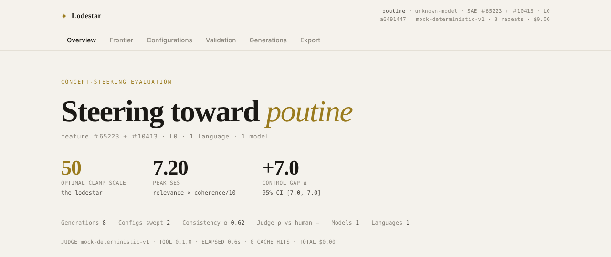
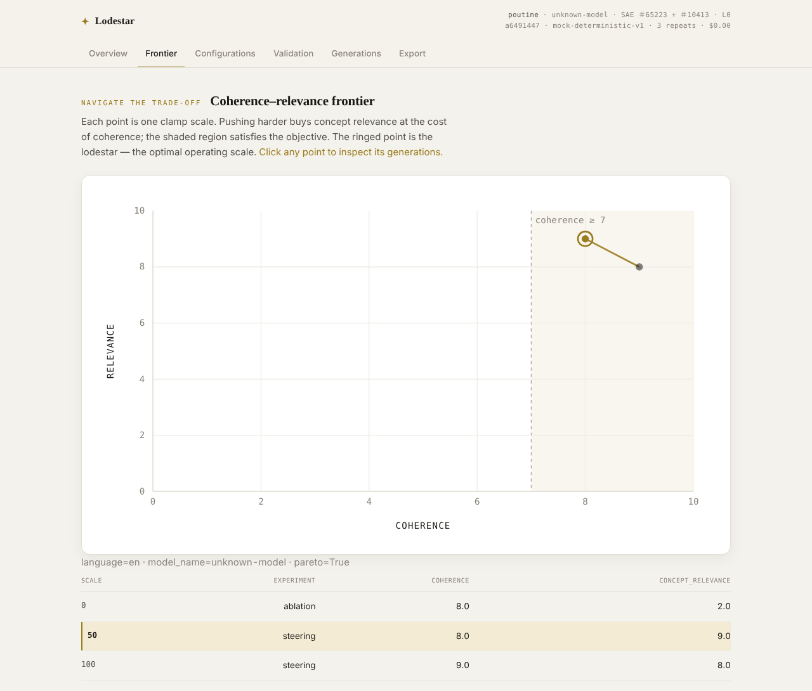
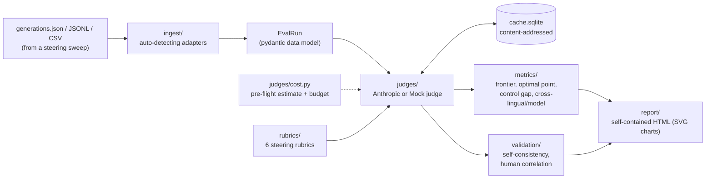

<p align="center">
  
</p>

<p align="center">
  <a href="https://github.com/mo-dev-x/lodestar/actions/workflows/ci.yml"></a>
  
  <a href="LICENSE"></a>
</p>

# Lodestar

**Lodestar is a command-line tool that grades AI-generated text from "steering" experiments.** It uses an LLM as a judge, checks that the judge is reliable, and turns the scores into one HTML report you can share. Results are cached so a re-run costs nothing, and a budget limit stops a run from overspending.

**In technical terms:** Lodestar is an evaluation harness built for sparse-autoencoder (SAE) activation-steering research. It ingests a sweep's `generations.json` with no changes to the steering pipeline. It scores each generation on six rubrics with an Anthropic or mock judge, and computes a coherence/relevance Pareto frontier, the optimal clamp scale and a steered-vs-random-control gap with bootstrap CIs. It also validates the judge: self-consistency with Krippendorff's α, ICC(2,1) and Fleiss' κ, and correlation with human labels. Judgments go into a content-addressed SQLite cache.

<p align="center">
  
</p>
<p align="center">
  
</p>
<p align="center"><sub>Report generated offline from the bundled sample sweep (<code>tests/fixtures/generations_sample.json</code>) with the mock judge, using the <a href="#offline-run-no-api-key-no-cost">offline quickstart</a> below. The numbers are fixture output, not research results.</sub></p>

> Part of a three-repo interpretability toolkit, see [Related projects](#related-projects).

---

## Key features

- **Steering-native data model.** Each generation carries its `SteeringConfig` (SAE checkpoint, layer, feature IDs and weights, clamp scale, decoding parameters), its condition (`baseline` / `control` / `steered`), its language and its model. Pydantic v2 models make this data typed and validated. Comparisons across scales, languages and models come straight out of the data model.
- **Six judged rubrics.** They are `coherence`, `concept_relevance`, `literal_mention` (computed deterministically *and* judged), `prompt_adherence`, `integration_naturalness` and `degeneration_flags`. Every judgment keeps its rationale, judge model, rubric version and token usage.
- **A control arm, not just a before/after.** `control_gap` measures `relevance(steered) − relevance(control)` at matched scale, language and model. It comes with a bootstrap 95% CI (2,000 resamples) and a two-sided Mann–Whitney U test. The comparison is against a *random* feature clamped just as hard, not against an un-steered baseline.
- **Judge validation built in.** Each `(generation, rubric)` pair is judged *k* times to check self-consistency. A human-labelling export and import gives Spearman ρ / Kendall τ (ordinal) or Cohen's κ (binary) against the judge. The statistics are tested against textbook values with published answers (`tests/test_stats.py`).
- **Cost safety.** `lodestar estimate` prices a run against the local cache and makes no API calls. `lodestar eval --budget` refuses to start a run predicted to cost more than the budget. A moving model *alias* is refused unless you pass `--allow-alias`, so the judge cannot silently change between runs.
- **Free re-runs.** The judgment cache is keyed by `(text, rubric name/version, judge model, repeat)`. You only pay again after changing generation text, a rubric version or the judge.
- **Self-contained HTML report.** Seven deep-linkable tabs. The charts are hand-written SVG, so the page has no plotting library or JS chart framework. Panels appear only when the data supports them: a single scale point is not drawn as a curve.
- **Extensible.** A `Judge` protocol, a metric plugin registry (`register_metric()`) and pluggable ingestion adapters (the pipeline's nested JSON, plus generic JSON, JSONL and CSV).

## Architecture



The full design, covering the data model, rubric prompts, cache keys and statistics, is in [`ARCHITECTURE.md`](ARCHITECTURE.md). The development history is in [`CHANGELOG.md`](CHANGELOG.md).

## Tech stack

Python 3.11+ · [Typer](https://typer.tiangolo.com/) (CLI) · Pydantic v2 · the `anthropic` SDK (async, structured output) · `tenacity` (retries) · `aiosqlite` (cache) · NumPy / SciPy / pandas (statistics) · Jinja2 + hand-written SVG (report). Tooling: pytest + pytest-asyncio, Ruff, mypy in `--strict` mode, and GitHub Actions CI on Python 3.11, 3.12 and 3.13.

## Quickstart

```bash
git clone https://github.com/mo-dev-x/lodestar.git
cd lodestar
python -m pip install -e ".[dev]"
lodestar --help
```

### Offline run (no API key, no cost)

The repo ships a small sample sweep. `--judge mock` uses a deterministic, zero-cost judge. Its scores are engineering fixtures, not research results.

```bash
lodestar eval tests/fixtures/generations_sample.json --target-concept poutine --judge mock -o run
lodestar optimal run --objective "max concept_relevance s.t. coherence >= 7"
lodestar report run -o report.html          # open report.html in a browser
```

### Real run with a Claude judge

```bash
# 1. Price the run first. No API calls are made.
lodestar estimate results/steering/generations.json --judge claude-sonnet-4-5-20250929

# 2. Judge it, refusing to start if the estimate exceeds $25.
export ANTHROPIC_API_KEY="..."
lodestar eval results/steering/generations.json --target-concept poutine \
  --judge claude-sonnet-4-5-20250929 --budget 25 -o run

# 3. Analyse, validate against humans, and report.
lodestar optimal run --objective "max concept_relevance s.t. coherence >= 7" -o run/optimal.csv
lodestar validate run --export labels.html          # stratified sample to label by hand
lodestar validate run --human labels_filled.csv     # judge-vs-human correlation
lodestar report run -o report.html
```

`estimate` needs a model that appears in the pricing table in `lodestar/judges/cost.py`, and `mock` is not in that table. That table is maintained by hand, so check it against Anthropic's current pricing before a paid run.

### Python API

```python
from lodestar import EvalRun
from lodestar.metrics import coherence_relevance_frontier

run = EvalRun.load("run")
frontier = coherence_relevance_frontier(run)
print(frontier[frontier.pareto])
```

Every command, flag, input format, output file and report tab is documented in [`USAGE.md`](USAGE.md).

## Project structure

```
lodestar/
├── cli.py              Typer CLI: estimate / eval / optimal / compare / validate / report
├── models.py           pydantic data model: SteeringConfig, Generation, Judgment, EvalRun
├── config.py           run configuration, API-key resolution, seeds
├── ingest/             steering_json.py (pipeline format) and generic.py (JSON/JSONL/CSV)
├── rubrics/            rubric base class + the six steering rubrics and their prompts
├── judges/             Judge protocol, Anthropic judge, mock judge, SQLite cache, cost model
├── metrics/            derived metrics (frontier, optimal point, control gap), stats, plugin registry
├── validation/         self-consistency and human-correlation
└── report/             HTML generator, section detection, hand-written SVG charts, Jinja template
tests/                  pytest suite + fixtures (sample sweep, textbook Krippendorff example)
ARCHITECTURE.md         design specification
CHANGELOG.md            dated development log
```

## Testing

```bash
pytest            # full suite, offline: it uses the mock judge only
ruff check .
mypy lodestar     # strict mode
```

CI runs those three commands on Python 3.11, 3.12 and 3.13 for every push and pull request ([`.github/workflows/ci.yml`](.github/workflows/ci.yml)).

## Roadmap and limitations

What works today: the six commands above, the six rubrics, the cache, the cost preflight, both validation paths and the HTML report. Known gaps:

- **Only one real judge backend.** The `Judge` protocol is judge-agnostic, but only `AnthropicJudge` and `MockJudge` are implemented. An OpenAI or local-model judge, which would let you check that results hold across judge models, has not been written yet.
- **The real Anthropic judge is exercised by hand, not in CI.** CI uses the mock judge only. Spot-check the live API path, including the shape of its structured-output request, against the current `anthropic` SDK before you rely on it.
- **Snapshot pinning is enforced at the CLI only.** A caller who builds `AnthropicJudge(...)` directly from Python must pass a pinned snapshot themselves.
- **Self-consistency is a determinism check, not a correctness guarantee.** A judge that is consistently biased would still pass it. Report the human-correlation numbers alongside it, never instead of it.
- **The generic ingestion adapter can merge generations that differ only in an `experiment` label.** The first-party steering adapter avoids this by folding `experiment` into its prompt hash, and custom adapters should do the same.
- **A broken custom metric takes down the whole report**, by design, so a plugin's bug is never silently swallowed.
- **The report loads Google Fonts** when it is opened, and falls back to system fonts when offline.
- **Pricing is hand-maintained** in `lodestar/judges/cost.py` and will go stale.
- **Planned docs.** `ARCHITECTURE.md` mentions `RUBRICS.md`, `VALIDATION.md` and `EXTENDING.md`, and these have not been written yet.

## Related projects

Lodestar is one of three repositories built during a mechanistic-interpretability research internship at IID:

| Repository | Role |
|---|---|
| [**Interlab**](https://github.com/mo-dev-x/Interlab) | The laboratory. It trains, certifies and causally validates sparse autoencoders on open-weight LLMs, and records every result under a content hash. Its judged steering evaluations run through Lodestar. |
| **Lodestar** (this repo) | The judge. It scores steered generations, validates the judge itself, and reports the results. |
| [**SAE Concept Lab**](https://github.com/mo-dev-x/sae-concept-lab) | The demo. A Gradio app for turning one SAE feature up or down while chatting with Gemma or Qwen. |

## License and citation

MIT licensed, see [`LICENSE`](LICENSE). Citation metadata is in [`CITATION.cff`](CITATION.cff):

```bibtex
@software{el_yaakoubi_lodestar,
  author  = {El Yaakoubi, Mohamed El Yazid},
  title   = {Lodestar: Steering-native evaluation for interpretability research},
  year    = {2026},
  license = {MIT},
  url     = {https://github.com/mo-dev-x/lodestar}
}
```

## Author

Mohamed El Yazid El Yaakoubi, Software Engineering student at Université Laval and Research Intern in Mechanistic Interpretability at IID. [GitHub](https://github.com/mo-dev-x) · [LinkedIn](https://www.linkedin.com/in/mohamed-el-yazid-el-yaakoubi/)
